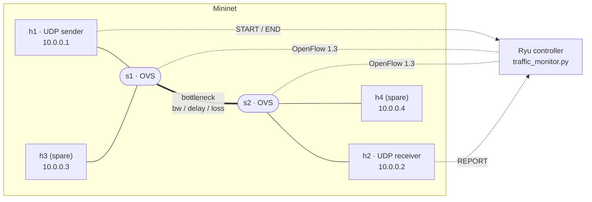
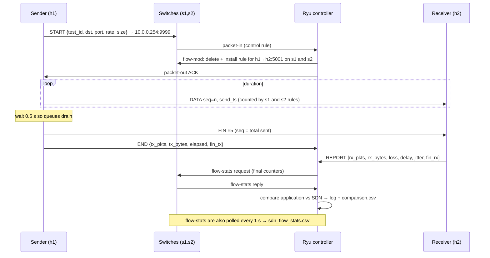

# Architecture

## 1. Problem and objectives

**Problem statement:** develop a UDP-based traffic measurement application and
compare application-level bandwidth measurement with SDN flow statistics.

Objectives (from the project expectations):

| Expectation | Where it is implemented |
|---|---|
| Generate UDP measurement traffic | `app/udp_sender.py` (paced, rate/size/duration configurable) |
| Count transmitted packets | sender counters, reported in `END` and `app_sender.csv` |
| Count received packets | receiver counters, reported in `REPORT` and `app_receiver.csv` |
| Calculate throughput | receiver (per-second and per-test), sender achieved rate |
| Collect SDN flow statistics | `controller/traffic_monitor.py` polls OpenFlow flow stats every 1 s |
| Measure packet loss | from sequence numbers (app) and ingress-vs-egress counters (SDN) |
| Compare application and network measurements | `controller/comparison.py` -> `comparison.csv` |
| Analyze different traffic loads | `--rate`, `--size`, `--bw`, `--loss` options (experiments in D2) |

## 2. System architecture

* The topology is loop-free, so a plain L2 learning switch is enough in D1.
* Loss can only happen on the `s1-s2` bottleneck, which is where both
  measurements are able to see it: `s1` counts packets before the bottleneck,
  `s2` counts the ones that survived.

## 3. Components

| Component | Role |
|---|---|
| **UDP sender** | Sends DATA packets at a fixed rate (`--rate`, `--size`, `--duration`), then FIN packets with the total count. Registers the test with the controller. |
| **UDP receiver** | One socket serves many senders; per-(sender, test) state. Tracks loss (sequence bitmap), duplicates, reordering, throughput, one-way delay, jitter (RFC 3550). Reports to the controller. |
| **Ryu controller** | L2 learning switch, ARP proxy and datagram endpoint for the virtual control address, per-flow rules, flow-stats poller, comparison engine. |
| **Mininet topology** | 2 OVS switches, 4 hosts, `TCLink` bottleneck with configurable bandwidth, delay, loss and queue length. |

## 4. Communication flow of one test

## 5. Packet and message formats

### Measurement packet (network byte order)

| Offset | Size | Field | Notes |
|---|---|---|---|
| 0 | 2 | magic | `0x554D` ("UM") |
| 2 | 1 | type | 1 = DATA, 2 = FIN |
| 3 | 4 | test_id | identifies the test run |
| 7 | 4 | seq | DATA: sequence number; FIN: total DATA packets sent |
| 11 | 8 | send_ts | sender wall clock (double, seconds) → one-way delay |
| 19 | … | padding | zeros up to `--size` (19 … 1472 bytes) |

UDP is unreliable, so FIN is sent 5 times (`--fin-count`). If every FIN is lost,
the receiver falls back to `max_seq + 1`, and the controller still uses the
sender's authoritative `tx_pkts` for the loss comparison.

### Control channel (JSON in UDP, to `10.0.0.254:9999`)

| cmd | From | Fields | Controller action |
|---|---|---|---|
| `START` | sender | test_id, dst, port, rate_mbps, pkt_size, duration | register test, delete old rule (resets counters), install per-flow rule on each switch, ACK |
| `END` | sender | test_id, tx_pkts, tx_bytes, elapsed_s, fin_tx, send_errors | store sender counters, ACK |
| `REPORT` | receiver | test_id, src, rx_pkts, rx_bytes, loss, throughput, delay, jitter, fin_rx | store receiver counters, ACK, finalise comparison |

The sender and receiver retry each request up to 3 times if no ACK arrives, so
the control channel is reliable even though it runs over UDP. If no controller
answers, the test still runs (it is simply not compared).

**How a datagram reaches the controller without a real host behind
`10.0.0.254`:** each switch has a priority-100 rule matching
`udp, ipv4_dst=10.0.0.254, udp_dst=9999 → CONTROLLER`; the controller answers
ARP requests for `10.0.0.254` itself (ARP proxy) and replies with a packet-out
built with the Ryu packet library.

## 6. OpenFlow rules

| Priority | Match | Action | Installed |
|---|---|---|---|
| 0 | any | to controller | on switch connect (table-miss) |
| 100 | UDP to 10.0.0.254:9999 | to controller | on switch connect |
| 10 | UDP `ipv4_src, ipv4_dst, udp_dst` of one test | output to learned port | on START (proactive), or reactively on the first packet if START was missed |
| 5 | non-UDP IP traffic by `eth_dst` and `ip_proto` | output to learned port | reactively (ICMP etc.) |

The per-flow rule is installed **before** the first data packet. Otherwise the
first packet would be forwarded by packet-out and never counted by the rule,
giving an off-by-one between the application and the switch.

## 7. How the measurements are compared

| Metric | Application view | SDN view |
|---|---|---|
| Packets sent | sender `tx_pkts` | ingress switch packet_count (minus FINs) |
| Packets received | receiver `rx_pkts` | egress switch packet_count (minus FINs) |
| Loss | `tx_pkts − rx_pkts` | `ingress − egress` |
| Throughput | `rx_bytes · 8 / window` (UDP payload) | `egress_bytes · 8 / window` (L2 frame bytes), and payload-equivalent `(egress_bytes − 42·egress_pkts) · 8 / window` |

Accounting rules (implemented in `controller/comparison.py`):

* **Header overhead:** OpenFlow counts Ethernet frames, the application counts UDP
  payload, so raw SDN throughput is higher by `42 / packet_size`. The comparison
  reports both the raw L2 difference (expected) and the payload-equivalent
  difference (should be ≈ 0).
* **FIN packets** share the UDP port, so the switches count them. They are
  subtracted using the FIN counts reported by the sender (`fin_tx`) and receiver
  (`fin_rx`).
* **Common window:** all throughputs in the comparison use the sender's elapsed
  time, so differences come from byte accounting and not from clock or polling
  differences. The per-second series (`app_rx_timeseries.csv` vs.
  `sdn_flow_stats.csv`) show the time-resolved view; the controller's 1 s poll
  interval limits its resolution.
* **Clock:** one-way delay uses sender and receiver timestamps from the same
  clock, which is valid inside Mininet (all hosts share the machine's clock).

## 8. Output files

See the table in the README. Every test appends one row to `app_sender.csv`,
`app_receiver.csv` and `comparison.csv`, so repeated runs can be aggregated for
the D2 graphs.

## 9. Known limitations of D1

* Loop-free two-switch topology with L2 learning; no rerouting yet.
* Hosts must have been learned first (`pingall` is part of `--demo`) so that the
  controller can install the per-flow rule before the first packet.
* Python sender precision: at very high packet rates (small packets, high Mbps)
  the sender reports its achieved rate and warns if it is >5 % below target.
* Flow-stats resolution is the polling interval (1 s, `POLL_INTERVAL` env var).
* The sender and receiver are each a single process; concurrency is demonstrated
  on the receiver side (many senders on one socket, a separate reporting thread).
